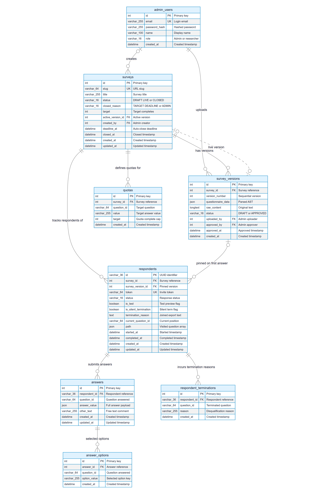
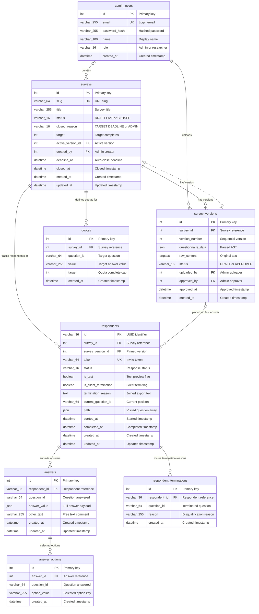

# Database Entity-Relationship (ER) Diagram

---

### Notes and Design Specifications

- **Unique constraints**:
  - `surveys.slug`
  - `respondents.token`
  - `admin_users.email`
  - `survey_versions (survey_id, version_number)`
  - `quotas (survey_id, question_id, value)`
  - `answers (respondent_id, question_id)`

- **Indexes**:
  - `surveys (status, deadline_at)`
  - `respondents (survey_id, status, is_test)`
  - `answers (question_id)`
  - `answer_options (question_id, option_value)`
  - `respondent_terminations (reason)` and `(question_id)`

- **Allowed values**:
  - `surveys.status`: `DRAFT`, `LIVE`, `CLOSED`
  - `surveys.closed_reason`: `TARGET`, `DEADLINE`, `ADMIN`
  - `survey_versions.status`: `DRAFT`, `APPROVED`
  - `respondents.status`: `NOT_STARTED`, `IN_PROGRESS`, `COMPLETED`, `TERMINATED`
  - `admin_users.role`: `admin`, `researcher`

- **Quota counts**:
  - Quota counts are computed from completed, non-test respondents via `answer_options`, never stored.

- **UTC Datetimes**:
  - All datetimes are stored in UTC.

- **Audit and Approvals**:
  - `survey_versions.approved_by` references `admin_users.id` (nullable, set upon approval) and is recorded in the notes rather than as a secondary connector to keep the visual layout clean and avoid crossing lines between `admin_users` and `survey_versions`.

- **Deliberate trade-offs**:
  - `respondents` holds both the invite token and the response session (one table, simpler).
  - `termination_reason` on `respondents` is a joined string kept only for export, while `respondent_terminations` is the source for dashboard counts.
  - `raw_content` is stored next to the parsed JSON so a version can be re-parsed or audited.
