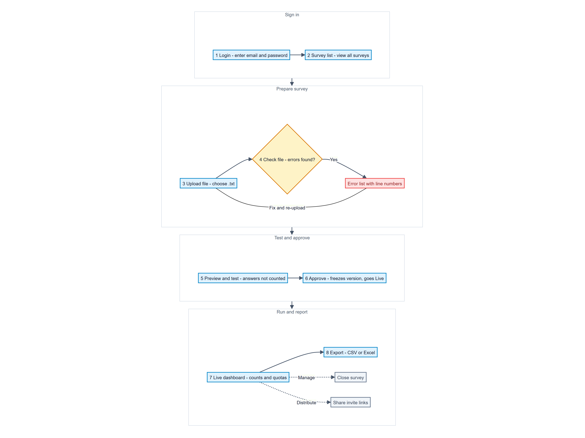
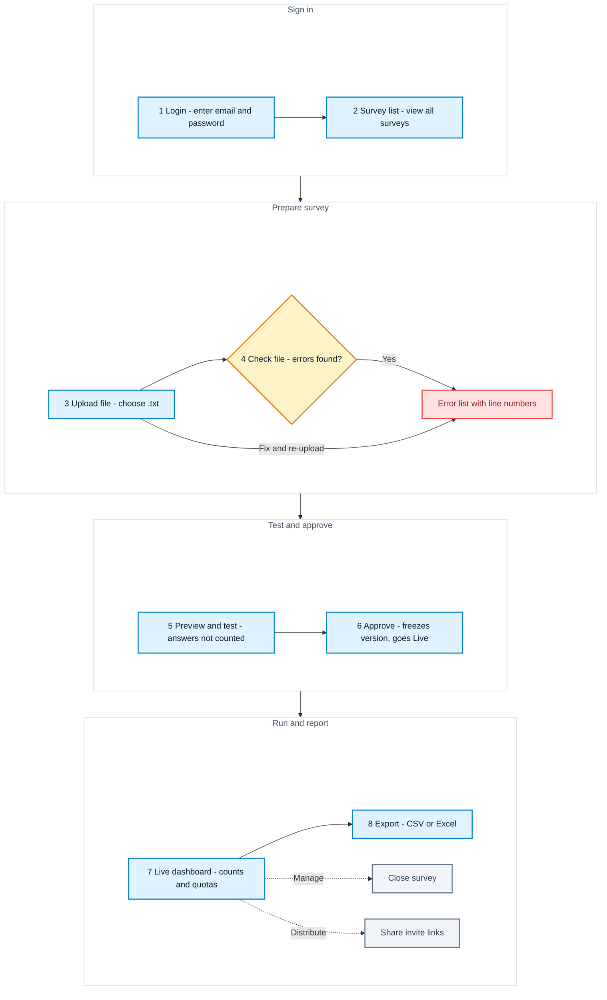

# Admin User Flow

*Legend: Blue boxes represent primary admin screens, amber diamonds represent decision checks, red boxes represent syntax errors, and grey boxes represent operational side actions. Thin bordered panels group related steps together.*

---

### What happens at each step

1. **Login**: The administrator enters their email and password, and the system authenticates the user session against their role.
2. **Survey list**: The user views all surveys with project metrics, target quotas, and publication status.
3. **Upload file**: The user selects a plain text questionnaire file and submits it for validation.
4. **Check file**: The system validates syntax and structure; if errors are found, line numbers are displayed and the user returns to re-upload, otherwise the draft advances.
5. **Preview and test**: The user tests interactive logic in sandbox mode where submitted answers are flagged as test data and excluded from quota counts.
6. **Approve**: The user approves the draft, which freezes the active version immutably, initializes quotas, and publishes the survey to live status.
7. **Live dashboard**: The user monitors live survey metrics, response progress, quota distribution, and study completion limits.
8. **Export**: The user downloads final response datasets in CSV or Excel format with unified column schemas.
