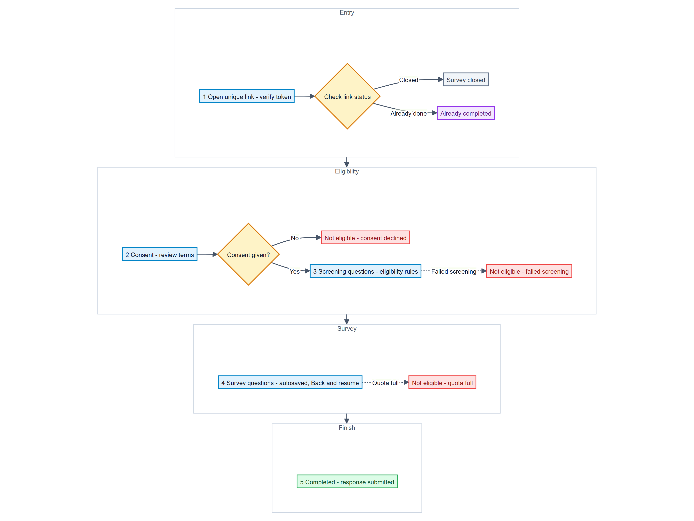
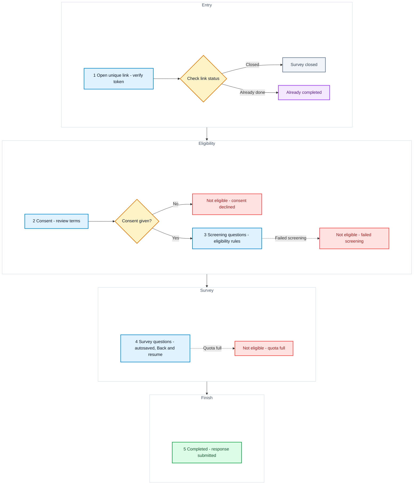

# Respondent User Flow

*Legend: Blue boxes represent active survey screens, amber diamonds represent decision gates, green boxes represent successful completion, red boxes represent disqualification screens, grey boxes represent closed surveys, and purple boxes represent repeat access attempts. Thin bordered panels group related steps together.*

---

### What happens at each step

1. **Open unique link**: The respondent accesses their invite token link, and the system verifies study availability to route closed or previously completed respondents to their respective screens.
2. **Consent**: The respondent reviews terms of participation and submits consent; choosing No routes directly to the Not eligible screen.
3. **Screening questions**: The respondent answers eligibility questions, the session pins to the active questionnaire version, and failing screening rules routes to the Not eligible screen.
4. **Survey questions**: The respondent completes main questions while the system autosaves responses, maintains the answered question path for Back navigation, and evaluates quota caps.
5. **Completed**: The system locks the survey row in a transaction to verify capacity before marking completion, showing the Completed screen or routing to Not eligible if quotas filled.
